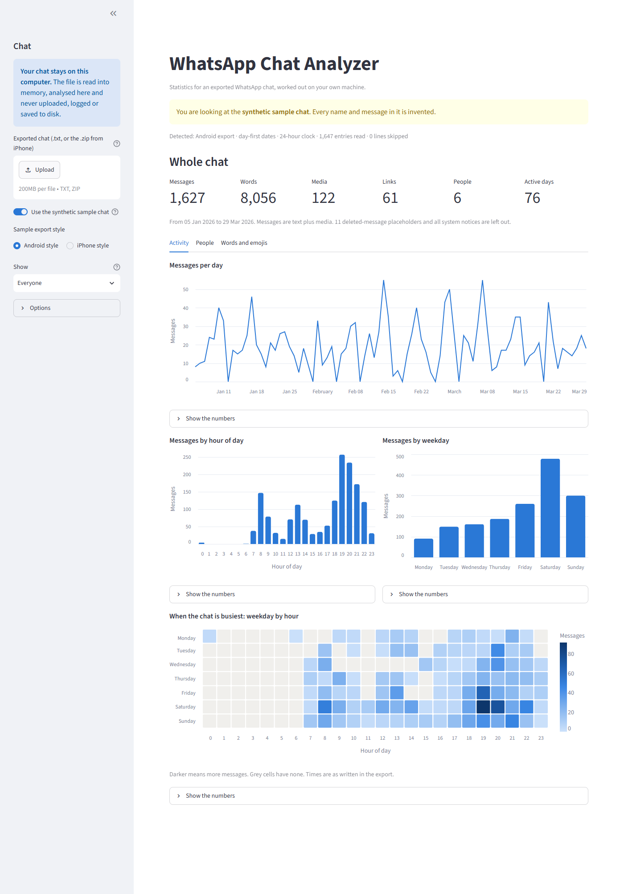
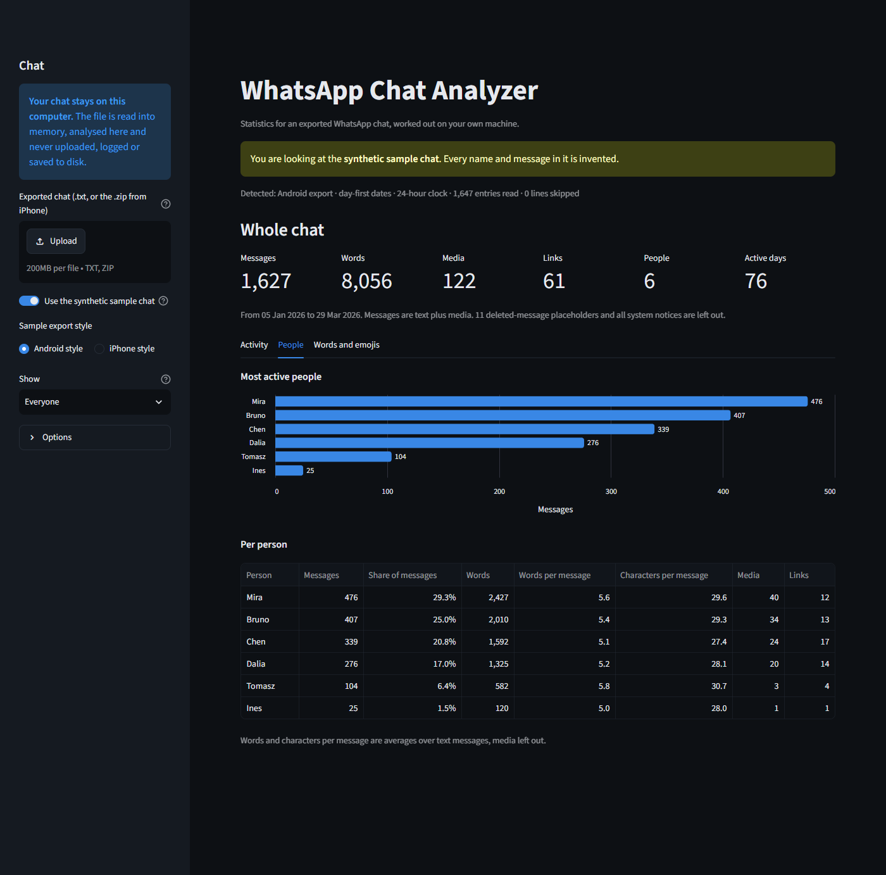
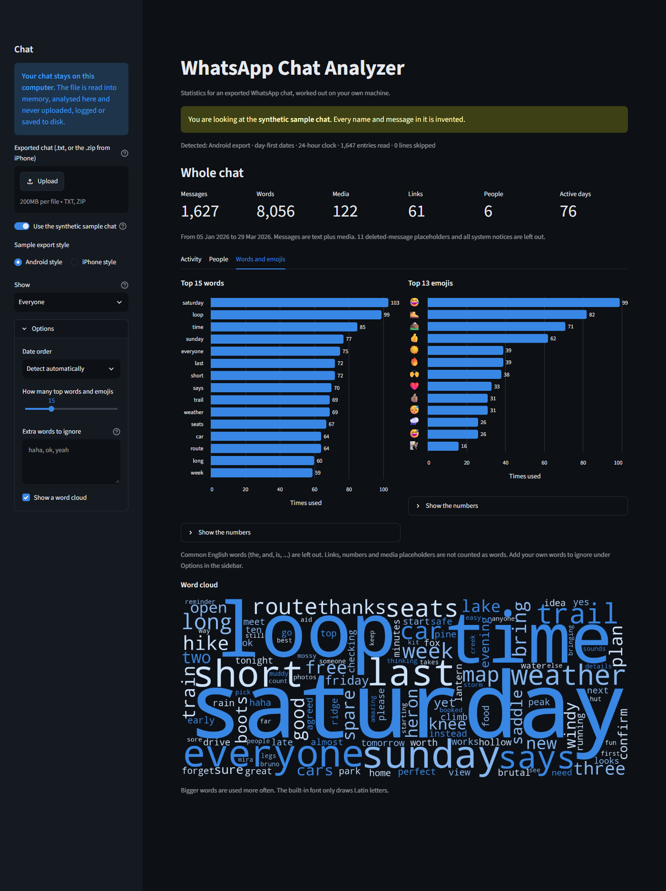
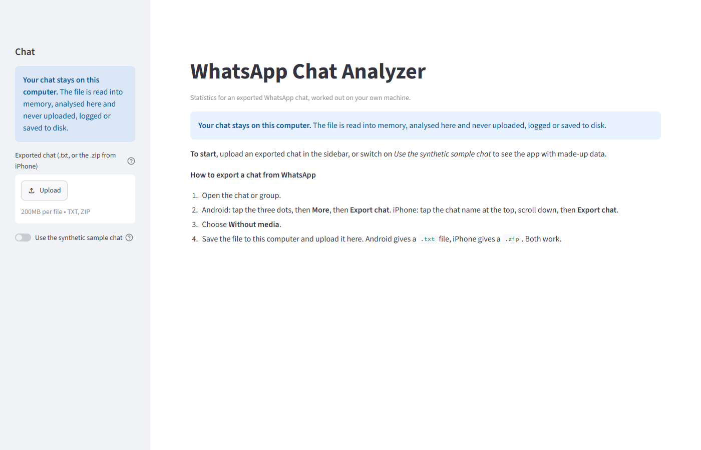
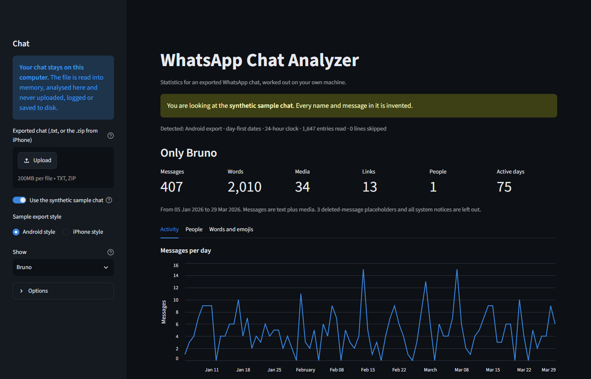
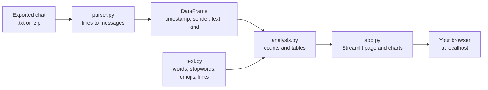

# whatsapp-chat-analyzer

[](https://github.com/Omkar210404/WhatsApp-Chat-Analyzer/actions/workflows/tests.yml)

A Streamlit app, and a small Python module behind it, that turns an exported WhatsApp chat into statistics and charts. **Everything runs on your own computer. The chat is never uploaded, logged or saved.**



Every screenshot and number in this README comes from running the app on a **synthetic sample chat**: a made-up hiking group written by [scripts/generate_sample_chat.py](scripts/generate_sample_chat.py). No real conversation was used to build, test or document this project.

## The problem

WhatsApp can export a chat as a text file, but the file is just thousands of lines. It does not tell you who talks the most, when the group is active, or what it talks about. The websites that answer those questions ask you to upload the chat, which means handing private conversations, yours and other people's, to a server you know nothing about.

This tool answers the same questions without the upload. You run it locally, open it in your browser at `localhost`, and the file never leaves your machine.

## What it does

- Reads the exported `.txt`, or the `.zip` an iPhone produces. Android and iPhone formats, 12-hour and 24-hour time, day-first and month-first dates, multi-line messages.
- Keeps real messages apart from system notices (joined, left, encryption notice), media placeholders (`<Media omitted>`) and deleted-message placeholders.
- **Overall**: messages, words, media, links shared, people, active days.
- **Per person**: messages, share of the chat, words, average message length, media, links.
- **Time patterns**: messages per day, per hour of day, per weekday, and a weekday-by-hour heatmap.
- **Top words and top emojis**, with an English stopword filter and a box for your own words to ignore.
- **Optional word cloud.**
- **Filter**: the whole chat or one person.

| People | Words and emojis |
|---|---|
|  |  |

| Start page | One person selected |
|---|---|
|  |  |

## Privacy

This is the point of the project, so here is exactly what is and is not done.

**What the app does with your chat**

- The file you pick is read into the memory of the Python process running on your computer. It is parsed and counted there.
- It is not uploaded anywhere. The code that handles your chat imports no networking module.
- It is not written to disk and no message text is logged or printed.
- Your browser talks only to `localhost`, which is that same Python process.

**Settings that matter** ([.streamlit/config.toml](.streamlit/config.toml))

- `gatherUsageStats = false`. Streamlit sends anonymous usage statistics by default. This turns that off.
- `address = "localhost"`. The app listens on your machine only, so other devices on your Wi-Fi cannot open it.

**How this is checked**

- [tests/test_privacy.py](tests/test_privacy.py) fails if the app or the module imports a networking or logging module, calls anything that writes a file or prints, or if either setting above is changed. These are checks on the source code. They catch accidents; they are not a proof.
- [scripts/capture_screenshots.py](scripts/capture_screenshots.py) records the host of every request the browser makes while it loads the app and clicks through all tabs. In the run that produced the screenshots here, the only host contacted was `localhost`.
- What was not measured: the network activity of the Python process itself. The evidence for that side is the source check above, not a traffic capture.

**What this does not protect you from**

- **Hosting it.** If you deploy this app to a public server or a cloud service, every chat opened there is uploaded to that server. That is why there is no hosted demo. Run it locally.
- **The export file.** WhatsApp saves the export as a plain, unencrypted file. Delete it when you are done.
- **Other people in the chat.** They did not agree to be analysed. Keep what you learn to yourself.
- **Your own machine.** Browser extensions, screen sharing and backups are outside what this app controls.

**Keeping real chats out of git.** [.gitignore](.gitignore) ignores every `.txt` and `.zip` in the repository except the five files it names (two requirement files, the stopword list, the two synthetic samples). A real export dropped anywhere in the folder cannot be committed by accident.

## How it works



All of it runs in one Python process on your computer.

The parser decides line by line whether a line starts a new message. A line that does not start with a timestamp belongs to the message above it, which is how multi-line messages stay together. Each message gets one of four kinds:

| Kind | Example | Counted as a message | Used for words and emojis |
|---|---|---|---|
| `text` | `Mira: See you at 7` | yes | yes |
| `media` | `Mira: <Media omitted>` | yes | no |
| `deleted` | `Mira: This message was deleted` | no, shown separately | no |
| `system` | `Mira added Bruno` | no | no |

Whether dates are day-first or month-first is worked out from the whole file: one date with a number above 12 settles it. If no date in the file settles it, the app says so and lets you choose.

## Install

Needs Python 3.11 or newer.

```bash
git clone https://github.com/Omkar210404/WhatsApp-Chat-Analyzer.git
cd WhatsApp-Chat-Analyzer
python -m venv .venv
```

Activate the environment:

```bash
# Windows (PowerShell)
.venv\Scripts\Activate.ps1

# macOS / Linux
source .venv/bin/activate
```

Install the packages:

```bash
python -m pip install -r requirements.txt
```

On Windows, if pip stops with a long path error, clone the project into a folder with a shorter path. One of Streamlit's own files has a very long name.

## Run

```bash
streamlit run app.py
```

Your browser opens at `http://localhost:8501`. Switch on **Use the synthetic sample chat** in the sidebar to try it with made-up data, or upload your own export.

## How to export a chat from WhatsApp

1. Open the chat or group on your phone.
2. **Android**: tap the three dots, then **More**, then **Export chat**.
   **iPhone**: tap the chat name at the top, scroll down, then **Export chat**.
3. Choose **Without media**.
4. Send the file to your computer in a way you trust (a cable or your own cloud drive) and upload it in the app. Android gives a `.txt` file. iPhone gives a `.zip`. Both work as they are.

Menu names can differ slightly between WhatsApp versions.

## Use it as a Python module

The parser and the analysis functions do not need Streamlit.

```python
from whatsapp_analyzer import analysis, parse_file

result = parse_file("examples/sample_chat_android.txt")
print(result.style, result.date_order, result.clock)

df = result.to_dataframe()
print(analysis.overall_stats(df)["messages"])
print(analysis.per_person_stats(df)[["person", "messages", "share_pct"]].head(3))
print(analysis.top_words(df, n=3, extra_stopwords={"loop"}))
```

Output on the synthetic sample:

```text
android dmy 24h
1627
  person  messages  share_pct
0   Mira       476       29.3
1  Bruno       407       25.0
2   Chen       339       20.8
       word  count
0  saturday    103
1      time     85
2    sunday     77
```

## The synthetic sample

`python scripts/generate_sample_chat.py` writes the same invented conversation in two styles:

| File | Style |
|---|---|
| [examples/sample_chat_android.txt](examples/sample_chat_android.txt) | Android, day-first dates, 24-hour clock |
| [examples/sample_chat_iphone.txt](examples/sample_chat_iphone.txt) | iPhone, brackets, month-first dates, 12-hour clock with seconds |

It is a fictional hiking group with six fictional members over twelve weeks. The first message in the chat says it is synthetic. The generator uses a fixed seed, so it writes the same files every time, and a test checks that.

What the app reports for it (both styles give the same numbers):

| Entries read | Messages | Words | Media | Links | Deleted | System notices | People | Active days |
|---|---|---|---|---|---|---|---|---|
| 1,647 | 1,627 | 8,056 | 122 | 61 | 11 | 9 | 6 | 76 |

The sample is built to exercise the parser: multi-line messages, media, links, emojis with skin tones, a deleted message, an edited message, people joining and leaving, and a subject change. Because it is randomly generated from a small set of phrases, its patterns say nothing about how real groups behave.

## Tests

```bash
python -m pip install -r requirements-dev.txt
python -m pytest -q
```

Result on Windows 11 with Python 3.11.9:

```text
127 passed in 8.80s
```

| File | Tests | What it covers |
|---|---|---|
| `test_parser.py` | 63 | Both export styles, 12 and 24-hour time, date order detection, multi-line messages, system, media and deleted lines, hidden characters, empty and non-chat input, `.zip` files |
| `test_analysis.py` | 19 | Every statistic on a small hand-counted chat, plus consistency checks on the sample |
| `test_text.py` | 11 | Word splitting, stopwords, links, emojis with skin tones and joined emojis |
| `test_sample_data.py` | 9 | Both sample files parse to the same conversation and match what the generator wrote |
| `test_app_smoke.py` | 11 | The real app run headlessly: sample, person filter, options, uploads, error messages |
| `test_privacy.py` | 14 | No network, logging or file-writing code, telemetry off, `.gitignore` blocks chat exports |

GitHub Actions runs the same tests on every push, on Ubuntu and Windows with Python 3.11 and 3.13. The badge at the top shows the latest result.

Six files were also uploaded through the real browser interface: the Android sample, the iPhone sample as a `.zip`, a short 12-hour month-first chat, a chat with ambiguous dates, an empty file and a text file that is not a chat. All six behaved as intended, with a clear message for the last two.

## Limitations

- **Export formats vary by phone language and region.** The parser reads the common Android and iPhone layouts with English wording. In another phone language the timestamps usually still parse, but system notices and media placeholders are written in that language, so on iPhone they can be counted as normal messages.
- **Not checked against a real export.** By design no real chat was used. The formats were written from the documented export layouts and the parser is tolerant, but a layout I have not seen may not parse. The app shows the detected format and how many lines it skipped, so a problem is visible.
- **Ambiguous dates.** If every date in a chat has a day of 12 or lower, the file itself cannot say whether `03/04` is 3 April or 4 March. The app guesses from the order of the messages, warns you, and lets you set it.
- **No time zones.** Times are shown as written in the export, which is the local time of the phone that exported it.
- **A pasted chat inside a message.** A continuation line that looks exactly like the start of a message is read as a new message.
- **Names containing a colon and a space** are cut at the first one.
- **A media file with a caption** (exports made with media) counts as media, and the caption is not counted in the words.
- **English stopwords only.** Words in other languages are counted correctly, but their common words are not filtered unless you add them yourself.
- **The word cloud font draws Latin letters only.** Words in other scripts show as boxes there. The top words chart is not affected.
- **Speed.** Parsing and analysing a file of 98,820 entries (the sample repeated 60 times, 5.6 MB) took about 4 seconds on my laptop. The analysis is redone on every change in the sidebar, so very large chats feel slow.
- **It counts, it does not understand.** There is no sentiment, topic or relationship analysis, and the numbers should not be read as saying anything about people.

## Future ideas

- Date range filter.
- Stopword lists for more languages, starting with Hindi and Marathi.
- Recognise system and media wording in more phone languages.
- Response-time and conversation-starter statistics.
- Compare two people side by side.
- Download the tables as CSV, on request only.

## Project layout

```text
app.py                          Streamlit page, no parsing or maths
whatsapp_analyzer/
  parser.py                     text to messages to DataFrame
  analysis.py                   statistics over the DataFrame
  text.py                       words, stopwords, emojis, links
  stopwords_en.txt
scripts/
  generate_sample_chat.py       writes the synthetic sample
  capture_screenshots.py        takes the README screenshots (needs Playwright)
examples/                       the two synthetic sample chats
tests/
docs/screenshots/
.streamlit/config.toml          telemetry off, localhost only
.github/workflows/tests.yml
```

## License

MIT. See [LICENSE](LICENSE).

This project is not affiliated with WhatsApp or Meta.
